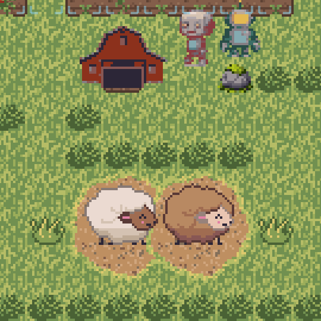
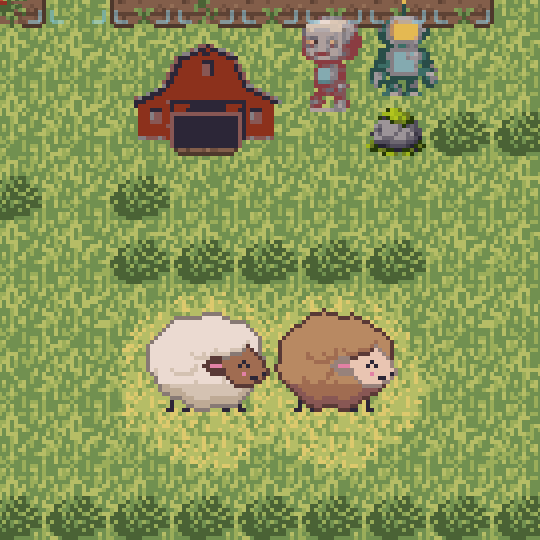
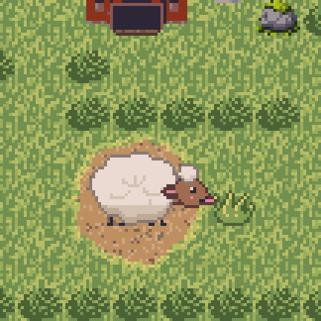
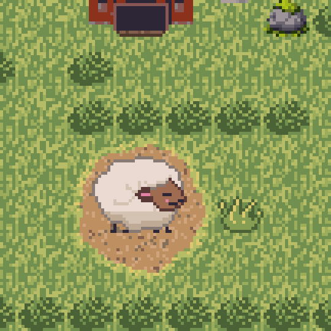
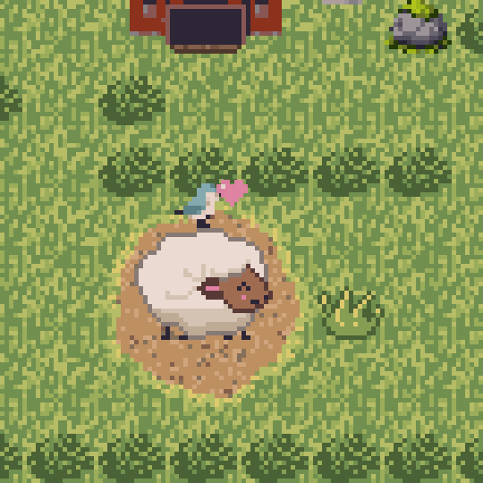

# 18 — Sheep

*Status: drafted and built (2026-10-13). Daniel's rulings are below in his words; the parts he
did not specify are a strawman, built as written, with every number in the table at the end
so he can retune it. The sheep art landed the same evening: eight looks of five coats (see
[Art](#art)).*

## Why sheep, and why there are no shears

A viewer asked "are there sheep?" under the creamery video. Daniel made sheep the next feature
and the subject of the next TikTok, with a twist he called "a monkey's paw version of game
development where we leave part of the feature missing": **sheep grow wool, and there is no
way to shear them.** The wool keeps growing until a sheep cannot move. It is meant to make
viewers ask for shears, which is the follow-up feature.

So this is deliberate, and every part of it is meant to stay as it is until shears are built:

- Nothing in the game removes wool. Wool is not an item: it cannot be collected or sold.
- A sheep that can no longer walk is not softened or rescued. Daniel: the sheep are
  "content/happy with their immobile condition".

## The five coats

Daniel ruled five adult coats: **freshly sheared, mid-growth, full coat, extra full coat,
extreme coat.** "Normally in any game they'd be sheared at full coat."

| Coat | What it does |
|---|---|
| Freshly sheared | Walks at her own pace. (No sheep in the game reaches this coat again: there are no shears. The Zoo and the video tools can show it.) |
| Mid-growth | Walks at her own pace. A bought sheep arrives in this coat. |
| Full coat | Walks at her own pace. |
| Extra full coat | Daniel: "their walk slows to 25% speed through doors and narrow (single width) passages (e.g. between debris in the yard if they are too enclosed) and accelerates back to 100% after clearing a bit from those spaces." |
| Extreme coat | Daniel: "the sheep literally becomes unable to take another step because they've become too fluffy." |

A coat grows one stage a night, at the sleep that turns the day, as a cow's milk does. A sheep
bought from the shop arrives mid-growth, so she has a full coat after her first night, an
extra full coat after her second, and the extreme coat after her third.

### The slowdown at the extra full coat

"Doors and narrow passages" are, for the game, these squares:

- a building's doorstep outside, and its doorway inside;
- any square she can cross whose two neighbours on one side-to-side line she cannot cross: a
  one-square gap between rocks, beds, fences or buildings.

A step onto or off one of those squares takes four times as long as her ordinary step (25%
pace). The three steps after it take her back up to speed: half pace, then three quarters,
then her own pace. All of this is decided in the simulation, not by the picture, so a saved
game and its replay agree on where she is at every moment.

### Stopping at the extreme coat

When her coat reaches the extreme, a sheep stops on the spot and stays there for good,
wiggling happily. There is one exception: **she never stops in a doorway, on a doorstep or in
a one-square gap.** If she is in one, she finishes squeezing through first and stops on the
first square past it. While she is moving through that final squeeze, she visibly
waddles: alternate hooves, a little weight shift and a one-pixel body bob. As soon as
she stops, her ordinary happy idle wiggle returns (2026-10-22).

- She never stops on a crop bed either: no animal stands on one (2026-10-11). A sheep whose
  coat goes extreme while she is crossing a bed walks off it first, and a strip of grass one
  square wide between two beds counts as a gap.
- If she was on her way to a stall, she gives the stall back before anything else, so no cow
  waits for ever on a sheep who never arrives.
- If she is boxed into a one-square pocket with nowhere she may stop within reach, she tries
  five times, a second apart, and then stops where she is.
- If she was resting in a stall, she stays in it, and the stall is hers for good. Daniel's brief
  calls that "fine and funny". Picking the barn up still works (2026-10-13): she is carried
  out through its doors onto the grass, still content, and the stall goes with the barn.

A stopped sheep never walls anyone in. In Tiny Farm animals do not block one another or the
farmer: the farmer's paths, the cows' and the hen's all go through a square another animal
stands on. So the doorway rule is about how it looks (a sheep wedged in the barn door forever
would read as a bug), not about anybody being trapped.

## Where sheep live

Daniel: "They're currently eligible to stay in any stall, including the red creamery barn. They
obviously cannot use the cream station currently, and we'll keep it that way. They take up a
slot that prevents a cow from having that slot."

- **Four places a barn, shared.** The barn's four-animal limit (S-41) counts cows and sheep
  together. With two cows and two sheep, neither a cow nor a sheep can be bought until there is
  another barn.
- **They graze outside, as cows do.** Now and then a sheep deciding where to graze next walks
  in through the barn's doors to rest in a free stall, rests there for a while, and walks back
  out. While she rests, the stall is hers: a cow with milk to give waits for a free one.
- **No milk.** A sheep never gives milk and never feeds the cheese line. The game refuses a
  sheep's "give milk" outright.
- No new buildings: stall animals stay a narrow class (cows and sheep) for now.

## Buying a sheep

After the barn. Daniel: from the barn, "the same way as an extra cow", "at about the same
price". The added cow is bought from the shop (the seed box) once a barn stands, so the sheep's
card sits beside the cow's card there, at **250 gold**, the added cow's price. She arrives
outside a barn's livestock doors on the same square an added cow would. Both cards go dark
together when the barns' places are full.

## Art

The art session delivers `assets/sprites/generated/sheep.png` with `sheep.json` beside it: five
rows in coat order (freshly sheared at the top, extreme at the bottom), four frames a row
facing right (mirrored for left, like the cow). The extreme row is a happy idle wiggle.
A separate four-frame waddle row per look covers her final steps out of a doorway or gap; it follows her simulated step, so
it holds still when paused and never plays on a stopped sheep. The game reads the cell
size and extra rows from `sheep.json`, keeping the idle and waddle pictures separate.

**Every sheep looks a little different** (Daniel, 2026-10-13: different face and fleece
colours and shapes). The sheet stacks its looks one under another, five coat rows each, and
`sheep.json` lists them under `looks`. The game counts the looks from that list, so Daniel can
keep as many as he likes. Which look a sheep wears is picked from her name (`sheep_1`,
`sheep_2`, …): the same sheep always looks the same, and the pick is only part of the picture,
so nothing about it is saved or replayed.

The extreme coat's wiggle holds each frame for a quarter of a second, the timing the art session
found reads best (`sheep.json`'s `idle_frames` note; the walk's frames follow her steps).

If the sheet is ever missing, the game draws a stand-in made from the cow's own four frames:
her white body turned the cream of wool, her face and legs a soft grey, and wool grown round
her a pixel thicker each coat (`entities/sheep_art.gd`). That is what the game drew before the
art landed.

## For the video

- **The Zoo** has a Sheep button. Each tap adds a sheep in the next coat: freshly sheared,
  mid-growth, full, extra full, extreme, and round again. Five taps put all five side by side.
- **Video shots** (`tools/record_video_shots.gd`, run through `video/tools/record_shot.sh`), on
  the creamery farm with its cows led away. The fourth argument picks the coats, dash-separated
  (0 freshly sheared to 4 extreme):
  - `sheepline` — a sheep in each coat on the grass below the barn (default `0-1-2-3-4`);
  - `sheepstalls` — inside, a sheep resting in each stall (default `1-2-3-4`);
  - `sheepdoor` — close on the doors: a full-coat sheep walks in at her own pace, then an
    extra-full one squeezes through at a quarter of it (default `2-3`);
  - `sheepstuck` — an extreme sheep, content where she stopped, the farmer walking past;
  - `sheepbuy` — the shop scrolled down to the sheep's card, a tap, and her arrival; `sheepbuy … full`
    has four sheep in the barn already, both cards' prices red and a tap on the cow refused;
  - `sheepgrow` — one sheep through three of the game's own nights, mid-growth to extreme.
- **Stills** (`godot --path . res://tools/capture_sheep.tscn`) write the pictures under
  [`mockups/sheep/`](mockups/sheep/): the five coats on the grass, the five coats in the barn,
  and a stopped sheep.

## The numbers to retune

| Number | Value | Where |
|---|---|---|
| Price of a sheep | 250 gold | `SimWorld.SHEEP_PRICE` |
| Places a barn (cows and sheep together) | 4 | `SimWorld.HERD_LIMIT` (S-41) |
| Coat a bought sheep arrives in | mid-growth | `Wool.BOUGHT_COAT` |
| Coats grown a night | 1 | `Wool.GROWTH_PER_NIGHT` |
| Pace in a doorway or a gap, extra full coat | 25% | `Wool.TIGHT_PACE` |
| Pace on the squares after one | 50%, then 75%, then 100% | `Wool.RAMP` |
| Her own pace | 1.25 squares a second (the cow's) | `SpeciesDefs` sheep row |
| Chance she goes in to rest, each time she picks a grazing spot | 20% | `SheepBrain.REST_CHANCE_PERCENT` |
| How long she rests in a stall | 20 to 40 seconds | `SheepBrain.REST_SECONDS` |
| How long each frame of the extreme coat's wiggle holds | 0.25 seconds | `sheep.json`, else `SheepArt.IDLE_FRAME_SECONDS` |
| How far a stuck sheep looks for somewhere to stop, and how often she tries | 4 squares, 5 tries | `SheepBrain.SETTLE_SEARCH`, `SQUEEZE_TRIES` |

## What is left for later

- **Shears**, on purpose. Removing wool, wool as an item and selling it are all the follow-up.

## Stuck for good

*Added 2026-10-13. Daniel picked these three gags the same evening to make "she is stuck
there for good" obvious at a glance. For the video, Daniel plays the developer who never
thinks of shears. He says he built them because "it felt like there wasn't anything to do
with the sheep once its fleece got too long". So none of them softens her stop, and none of
them hints at shears.*

### Her bald ring

A stuck sheep keeps grazing everything she can reach. Her own square goes to stubble as
soon as she stops, and the eight squares round her follow one at a time, 25 seconds
apart. The whole ring is stubble about four minutes into her first day stuck. After her
first night stuck it is all bare earth: a bald circle with a giant fluffball in the
middle.

- **Only field grass is grazed.** A crop bed, the yard, a weed, a fence, a building, or
  anything else standing on a square is left alone. A weed in her reach leaves a gap in
  her ring.
- **Two rings that overlap join into one bald patch.** Each square is cut from a round
  patch centred on its sheep, and the barer of two overlapping patches is drawn on top.
- **Only out on the farm.** A sheep who stopped in a stall grazes nothing: the barn floor
  isn't grass.
- **What the game keeps.** Her brain writes down the tick she stopped
  (`content_since`). At each day turn it counts the nights she has stood there
  (`nights_content`). The sim never reads either number; the picture is drawn from them.
  A farm saved before this change loads with any stuck sheep's ring already bare, since
  she has been there a while.
- **What it costs.** The picture is drawn after the farm's ground, square by square, but
  only on the nine squares round each stuck sheep. A farm without one pays for one pass
  over its animals and nothing more.

### The neck stretch

Once her ring is bare, every 14 seconds or so her happy wiggle gives way to a beat. She
reaches her neck toward a tuft of grass just past her ring and gets nowhere. Then she
settles back, looking smug. The tuft is real: the grass square two out on the side she
faces, drawn a little taller so it reads as the thing she wants. If there is no grass
there, she turns to the other side. If there is none on either side, she has nothing to
reach for and only wiggles.

Daniel's correction (2026-10-21, built 2026-10-22): the reach must look happy and
cheeky, with no discomfort. The four frames for each of the eight looks are reach
(eyes open on the grass), stretch (head forward at mouth height, tongue toward the
grass), lick (a little farther forward, eyes still open), and smug (head home,
eyelids half down, the original smirk). The stretch and lick hold in turn; they never
shake back and forth. She draws her head back before the smug hold, then returns to
her happy wiggle. Her fleece and hooves stay planted throughout the reach.

The sheet's cells are 56 pixels wide so her head has room to reach. The game centres
every cell on her square, keeping her body in the same place. Both the corrected
stretch and the waddle are presentation only: simulation, saves and replays are
unchanged.

### Birds sit on her

Every 40 seconds or so a songbird drops in, sits on her back for 12 to 22 seconds as if
she were a cloud, and flies off. When it lands she gets a little heart. These are
cosmetic birds, drawn with the songbird's own picture. They are not the crows, which are
pests a sheep would not welcome, and not the sim's songbird, which never visits a live
farm. Because they are only a picture, nothing about them is saved or replayed.

### Timing, and staging them for the video

Every beat is worked out from the sim clock and her name, never from the screen. A
paused game holds still, the same tick always shows the same moment, and two stuck
sheep never reach or get visited in step. The video tools can cue a beat on demand.
The game itself never does.

- **Video shot** `sheepgags` (`tools/record_video_shots.gd`). The fourth argument is
  `<ring>-<sheep>`. The ring is `grazing` (she has just stopped; a four-minute shot of
  the ring appearing, to speed up in the edit), `stubble` or `bare`, and the count is one
  sheep or two side by side. With a bare ring she reaches at 1.5 s and 15.5 s, and a
  bird lands at 5 s.

      video/tools/record_shot.sh video/<video> sheepgags 540x540 bare-2

- **Stills**: `godot --path . res://tools/capture_sheep_gags.tscn` writes the pictures
  in this section under [`mockups/sheep/`](mockups/sheep/).

| Number | Value | Where |
|---|---|---|
| Time between squares of her first day's grazing | 25 seconds | `SheepGags.GRAZE_SECONDS` |
| Nights before her ring is bare | 1 | `SheepGags.ring_is_bare` |
| How often she reaches for the tuft | every 14 seconds | `SheepGags.STRETCH_EVERY_SECONDS` |
| The reach itself | about 3 seconds, half of it smug | `SheepGags.STRETCH_BEAT` |
| How often a bird visits | every 40 seconds | `SheepGags.BIRD_EVERY_SECONDS` |
| How long it sits | 12 to 22 seconds | `SheepGags.BIRD_PERCH_SECONDS` |

### Reviewing the stretch and squeeze

The [eight-look comparison](mockups/sheep/gags_all_eight_before_after.png) pairs the
old effort pose with the corrected reach, using the same real-game scene and clock
for each look. The [native-size comparison](mockups/sheep/gags_all_eight_native.png)
shows one image pixel per game-art pixel. The [whole beat](mockups/sheep/gags_stretch_frames.png)
and [moving preview](mockups/sheep/gags_all_eight_moving.gif) include the unchanged
smug ending. These show the candidate for Daniel's visual approval; they do not
record approval.

`tools/capture_sheep_review.tscn` uses the real main scene and animal renderer. Pass
an absolute output folder after `--` to capture every look at exact clock ticks.
Use a 540×540 window at 30 fixed frames a second. `tools/compose_sheep_review.py`
places the matching before and after captures beside each other and makes the
native-size sheet and moving preview. The before pictures were captured at
`40805374` with the same capture tool.

For a movie, pass `squeeze` after the output folder and use Godot's `--write-movie`.
Godot takes the movie size from the project settings: temporarily set viewport width
and height to 540 in this checkout's `override.cfg` for a square movie, as the existing
video wrapper does; restore the file after recording. A 540×540 window alone is not
enough to change the movie size.
It stages an extreme sheep on the barn's doorstep, then another in a one-square gap
between rocks. Their own brains move and stop them. Each must show all four waddle
poses while moving and return to idle after settling; the capture exits with an
error if either fails. It writes only scratch saves, never a player's farm.
