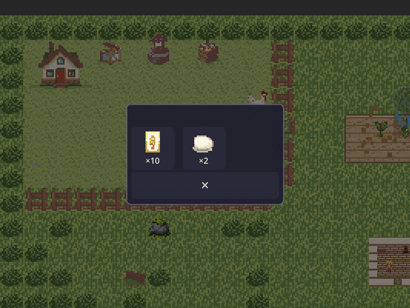
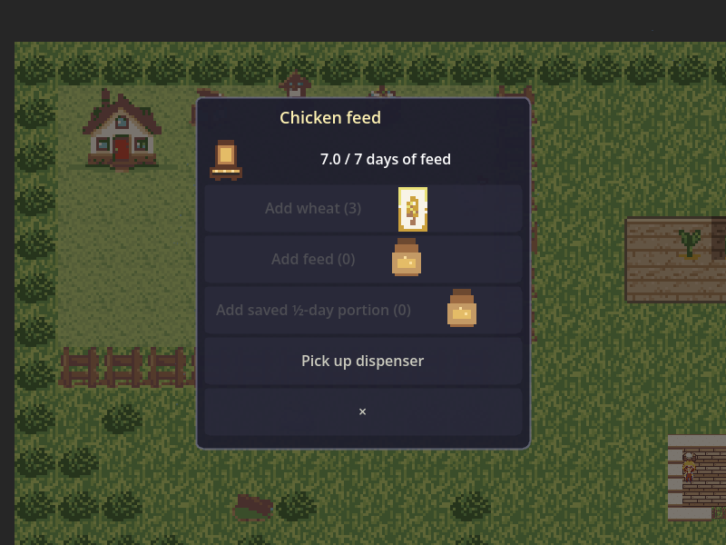
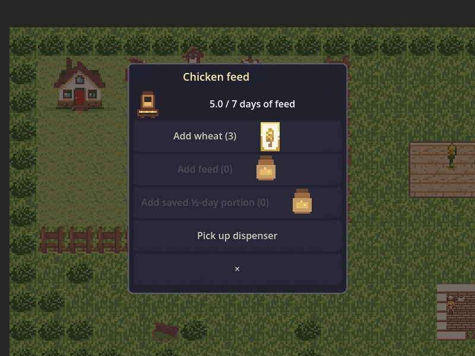
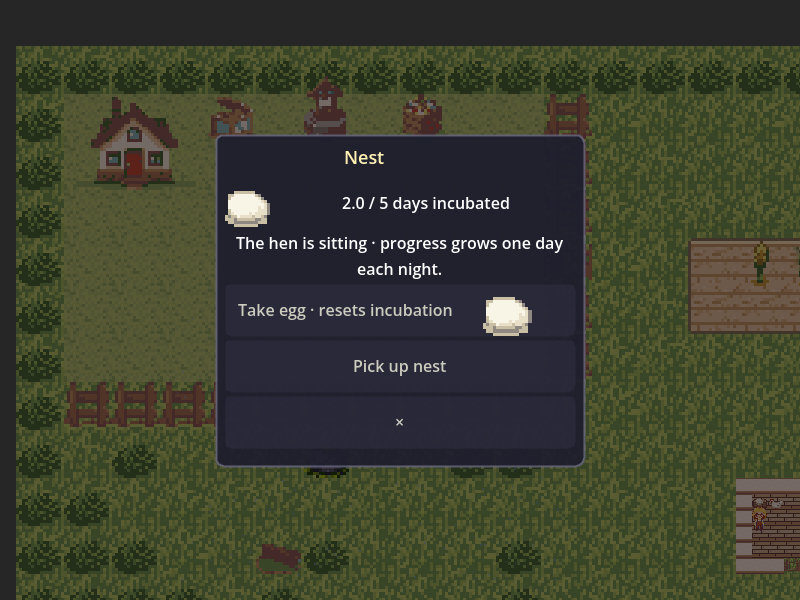
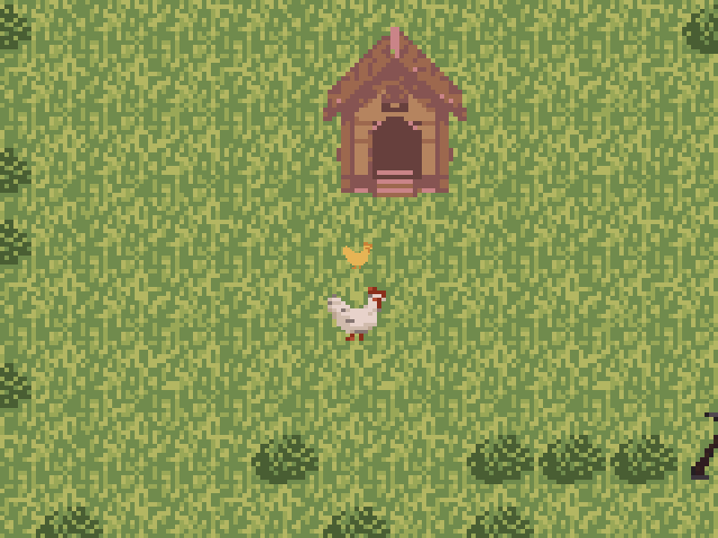
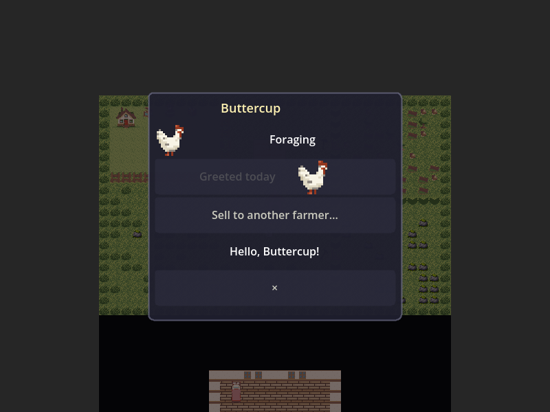
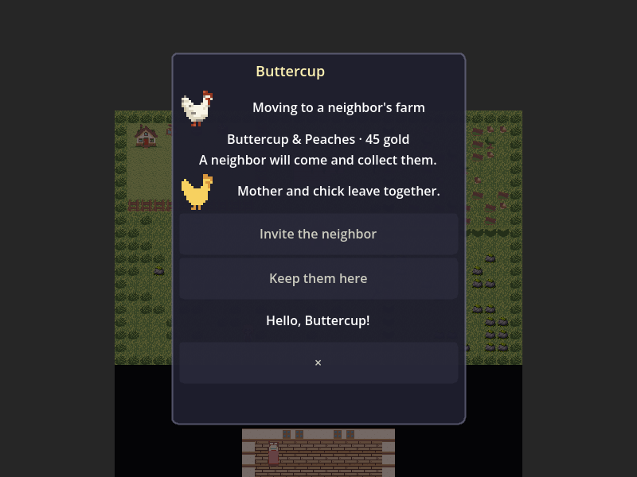
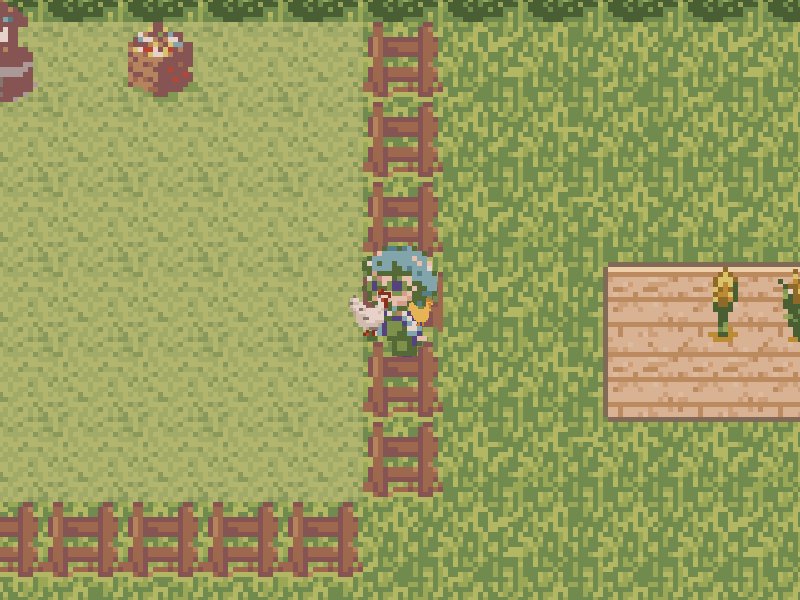

# Chicken families in the review build

Captured from the running game on 2026-10-31, using farm seed 20261031.
The hen enters the coop and the family moves through the real simulation;
the capture moves the observer and camera to show them. The walkthrough passes
29 checks, including checks that its subjects are visible in the correct area.

The [design and review notes](../../16-chicken-families.md) distinguish Daniel's
decisions from the prices and other completion details chosen for this build.
The review build was installed on Daniel’s tablet on 2026-10-31 at 1:29pm Pacific. The separate coop store update is awaiting a tablet refresh. No public release is authorized.

## Putting an egg into a nest

Collected eggs can be selected from inventory and placed in an empty coop nest.

## Supplying feed

The dispenser takes wheat or purchased feed. A full dispenser supports seven
incubation days; visiting chickens do not consume it.

## Watching incubation

Nest inspection shows progress explicitly. The hen must attend the nest;
without feed, progress retreats and the egg remains usable.

## Mother and chick

The mother raises her chick without supplied food. At seven days it becomes
independent; it stays small while both adult places are occupied.

## Getting to know a named chicken

Each chicken receives a name. Direct greetings build lasting familiarity,
expressed as an occasional idle approach toward the player.

## Selling to another farmer

Confirmation identifies the birds and price. A dependent mother and chick
leave together; the neighbor physically collects them and carries them away.

[The separate shop inside the coop](coop_shop/README.md) shows the change Daniel requested after tablet play.
