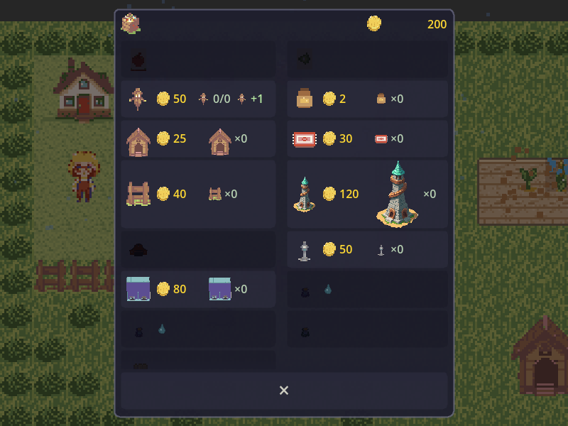
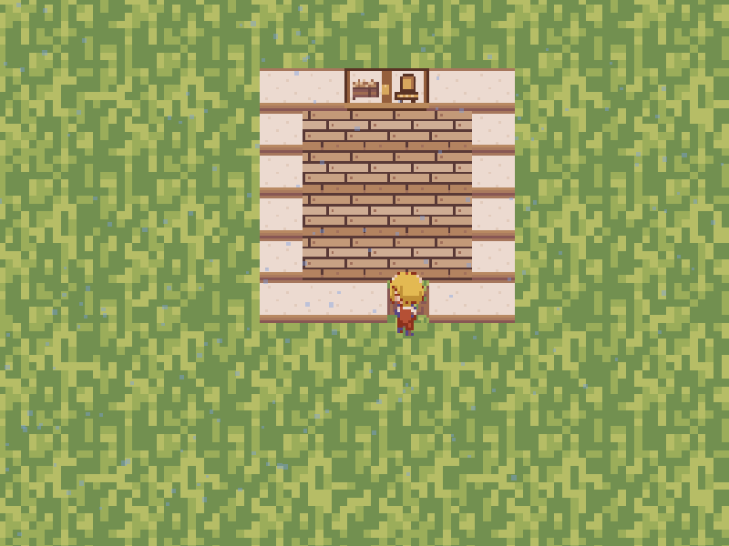
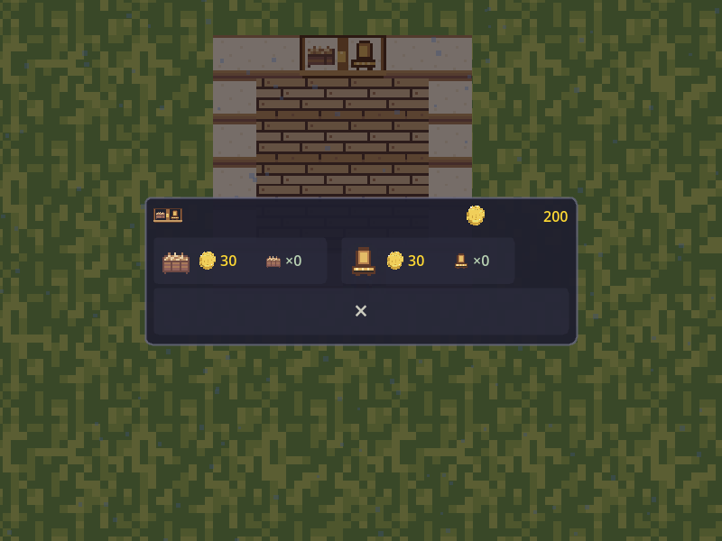
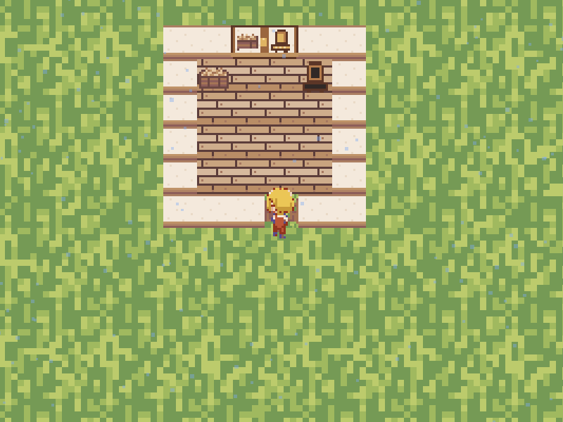

# The shop inside the coop

Captured from the running game on 2026-10-31 with `tools/capture_coop_shop.tscn`.
The scratch farm uses real shelf taps, purchase buttons, and fitting placement.
The capture checks passed 12 assertions.

